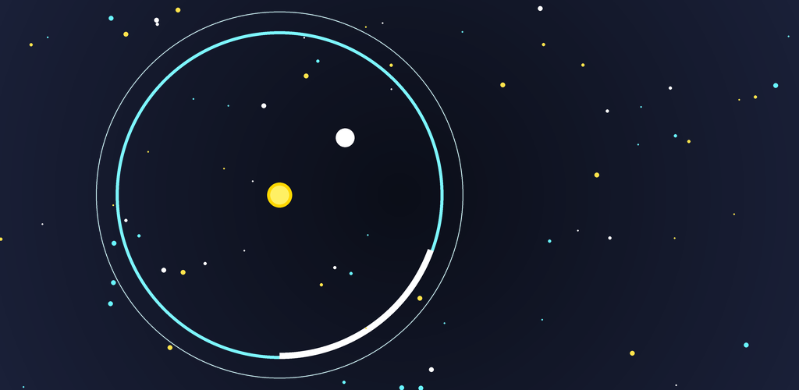

# Orbit Bounce (Pong Circular) 🪐⚪

<p align="center">
  
</p>

Jogo mobile 2D de ritmo rápido e reflexos no estilo **"Pong Circular / Breakout Orbital"** desenvolvido em **Godot 4.x** com **GDScript 2.0**.

Desenvolvido com física vetorial matemática precisa e renderização gráfica procedural via `CanvasItem._draw()`, sem dependência de texturas ou assets pesados.

---

## 📱 Downloads Oficiais (Android e Web)

- 📲 **[Baixar APK Android (Instalação Direta)](https://github.com/marcos-toliveira/orbit-bounce/releases/latest/download/orbit-bounce.apk)**
- 🌐 **[Baixar Pacote Web HTML5/WASM (Poki, CrazyGames & itch.io)](https://github.com/marcos-toliveira/orbit-bounce/releases/latest/download/orbit-bounce-web.zip)**

---

## 📸 Capturas de Tela (Gameplay)

| Fase 1: O Despertar (Neon Cyan) | Fase 3: Pinball Bumpers (Electric Blue) |
|:---:|:---:|
|  |  |

| Fase 4: Caos Triplo / Multiball (Emerald Lime) | Fase 5: A Hélice (Solar Amber) |
|:---:|:---:|
|  |  |

---

## 🎮 Mecânicas e Destaques

- **Orientação Mobile Portrait:** Resolução base calibrada para 720x1280.
- **Controle Ultra-Fluido:** Raquete em formato de cápsula arredondada que desliza pela borda via touch drag na tela do celular ou mouse/teclado no PC.
- **Passagem de Fases por Meta de Pontuação:** Cada fase possui uma meta clara (ex: 150, 350, 650, 1050 e 1600 pontos) com barra de progresso visual no topo do HUD.
- **Spawn Orgânico Contínuo:** Novos blocos quadradinhos e moedas surgem periodicamente no centro, garantindo ação ininterrupta e eliminando o problema do "último bloco".
- **Moedas Coletáveis (*Pass-Through*):** A bolinha atravessa as moedas sem desvios bruscos, garantindo trajetórias suaves e previsíveis.
- **Bloquinhos Quadradinhos Quebráveis:** Ricochete ortogonal limpo (eixos X/Y) estilo *Arkanoid*.
- **Torre Central Atiradora (Boss Hazard):** Torre rotativa que dispara projéteis vermelhos em direção ao jogador. Os tiros **nunca** causam Game Over direto: cada tiro reduz a largura da raquete (76° ➔ 54° ➔ 40° ➔ 26° ➔ 14° crítico), desafiando a precisão do jogador. A bola precisa acertar a torre para destruí-la!
- **Orbes Especiais e Poderes:**
  - 🟢 **Bichinho Verde (Expand):** Aumenta a raquete temporariamente para 76°, facilitando as defesas.
  - 🟣 **Gosma Tóxica (Shrink):** Encolhe a raquete para 36°, exigindo máxima concentração.
  - 🔥 **Bola de Fogo (Fireball):** Rastro incandescente, destrói blocos instantaneamente sem ricochetear e elimina a torre central em 1 golpe!
  - 🟡 **Multiball (3 Bolinhas):** Multiplica a bola em 3 trajetórias divergentes simultâneas.
- **Áudio 8-Bit Síntese Procedural:** Gerador de ondas de áudio PCM em tempo real via código GDScript (`AudioStreamWAV`), dispensando arquivos `.wav`/`.mp3` externos.
- **Sistema de Vidas (Candy Crush Style) & Timer de Recarga:**
  - Máximo de 5 vidas (`❤️ 5/5`). Vencer a fase não gasta vidas!
  - Ao ser eliminado, perde 1 vida, mas **não volta à Fase 1**.
  - Recarga automática a cada 3 minutos, com timer visível em tempo real.
  - As moedas ganhas nas partidas são permanentemente salvas no banco e podem ser usadas para recarregar +5 vidas ou comprar cosméticos.
- **Tela de Mapa de Fases (Level Progression Map):**
  - Navegue e jogue qualquer fase já desbloqueada para bater recordes.
  - Avaliação de desempenho por estrelas (⭐ / ⭐⭐ / ⭐⭐⭐) em cada fase.
  - Modo Infinito ♾️ liberado após zerar a Campanha.
- **HUD Centralizado e Números Flutuantes (Score Popups):**
  - Placar gigante posicionado estrategicamente logo acima da arena circular, facilitando a visualização durante o calor da partida.
  - Efeitos de texto flutuante em tempo real (`+25`, `+15 🪙`, `+150 💥`, `MULTIBALL! 🟡`) que saltam da posição exata do impacto.
- **Interface Oposta a Sobreposições & Telas Escuras Sólidas:**
  - Modais com fundo escuro sólido opaco, bordas neon e botões touch ergonômicos de 54px+.
  - Fim de Jogo com destaque gigante para a pontuação conquistada na rodada e opções claras de reviver ou tentar novamente.
- **Economia, Loja de Skins e Persistência:**
  - Salva automaticamente o seu Recorde Pessoal (*High Score*) e saldo de moedas no banco (`user://orbit_bounce_save.json`).
  - **Loja de Cosméticos & Recargas:** Desbloqueie skins luminosas (Clássico, Chama Solar 🔥, Synthwave Neon 💖 e Arco-Íris Mágico 🌈) e recarregue vidas com moedas.
  - **Loop de Recompensa:** Botão para reviver partida (1x por run com barreira protetora esmeralda) e dobrar moedas coletadas.

---

## 🚀 Como Executar no PC

### Pré-requisitos
- [Godot Engine 4.x](https://godotengine.org) instalado.

### Executando Localmente
1. Clone este repositório:
   ```bash
   git clone https://github.com/marcos-toliveira/orbit-bounce.git
   cd orbit-bounce
   ```
2. Abra no Godot:
   - Abra o Godot Editor e importe a pasta, **ou** execute diretamente via terminal:
   ```bash
   godot --path .
   ```

---

## 📜 Licença e Termos de Uso

Este projeto adota a licença **[PolyForm Noncommercial License 1.0.0](LICENSE)** (Source-Available / Código Aberto para Uso Pessoal e Educacional).

### ✅ O que você PODE fazer:
- Baixar, clonar e inspecionar o código-fonte livremente.
- Compilar e jogar na sua máquina ou dispositivo pessoal para entretenimento próprio e estudos.
- Modificar o código para fins pessoais e educacionais.

### ❌ O que você NÃO PODE fazer:
- Vender, alugar, sublicenciar ou comercializar o código ou seus binários.
- Publicar ou distribuir o jogo (ou derivados) em lojas comerciais de aplicativos (Google Play, Apple App Store, Steam, etc.).
- Monetizar o jogo (anúncios, compras no app ou distribuição paga).

> **Direitos Comerciais:** Todos os direitos de exploração comercial, publicação em lojas e monetização são reservados exclusivamente a **Marcos T. Oliveira** (`marcos-toliveira`).
