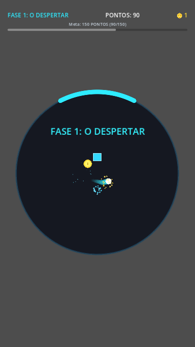
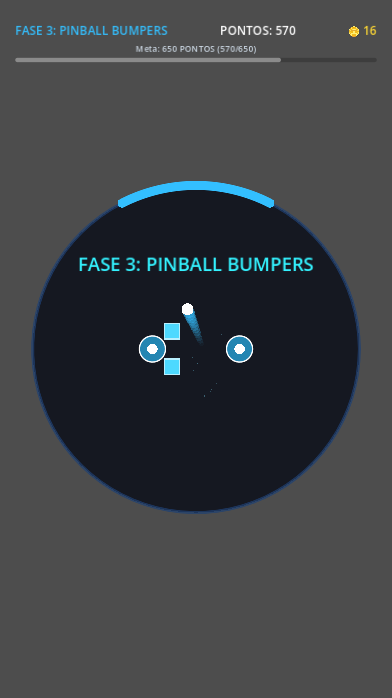
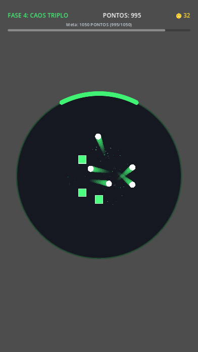
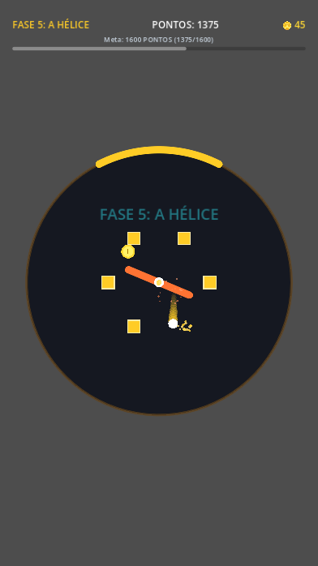

# Orbit Bounce (Pong Circular) 🪐⚪

Jogo mobile 2D de ritmo rápido e reflexos no estilo **"Pong Circular / Breakout Orbital"** desenvolvido em **Godot 4.x** com **GDScript 2.0**.

Desenvolvido com física vetorial matemática precisa e renderização gráfica procedural via `CanvasItem._draw()`, sem dependência de texturas ou assets pesados.

---

## 📱 Baixe e Jogue no Android

O jogo já possui build compilada e pronta para instalar no seu smartphone:

👉 **[Baixar APK Oficial (Releases)](https://github.com/marcos-toliveira/orbit-bounce/releases/latest/download/orbit-bounce.apk)**

---

## 📸 Capturas de Tela (Gameplay)

| Fase 1: O Despertar (Neon Cyan) | Fase 3: Pinball Bumpers (Electric Blue) |
|:---:|:---:|
|  |  |

| Fase 4: Caos Triplo / Multiball (Emerald Lime) | Fase 5: A Hélice (Solar Amber) |
|:---:|:---:|
|  |  |

---

## 🎮 Mecânicas e Destaques

- **Orientação Mobile Portrait:** Resolução base calibrada para 720x1280.
- **Controle Ultra-Fluido:** Raquete em formato de cápsula arredondada que desliza pela borda via touch drag na tela do celular ou mouse/teclado no PC.
- **Passagem de Fases por Meta de Pontuação:** Cada fase possui uma meta clara (ex: 150, 350, 650, 1050 e 1600 pontos) com barra de progresso visual no topo do HUD.
- **Spawn Orgânico Contínuo:** Novos blocos quadradinhos e moedas surgem periodicamente no centro, garantindo ação ininterrupta e eliminando o problema do "último bloco".
- **Moedas Coletáveis (*Pass-Through*):** A bolinha atravessa as moedas sem desvios bruscos, garantindo trajetórias suaves e previsíveis.
- **Bloquinhos Quadradinhos Quebráveis:** Ricochete ortogonal limpo (eixos X/Y) estilo *Arkanoid*.
- **Multiball (3 Bolinhas Simultâneas):** Poder especial que multiplica a bola em 3 trajetórias com divergência angular.
- **Pinball Bumpers & Hélice Rotativa:** Obstáculos elásticos que aumentam o impulso e lâmina central giratória que transfere momento angular.
- **Efeitos "Juicy":** Partículas 2D estilo fogos de artifício (*Tchiu!*), rastro luminoso (*trail*) e tremor sutil de tela (*screen shake*).

---

## 🚀 Como Executar no PC

### Pré-requisitos
- [Godot Engine 4.x](https://godotengine.org) instalado.

### Executando Localmente
1. Clone este repositório:
   ```bash
   git clone https://github.com/marcos-toliveira/orbit-bounce.git
   cd orbit-bounce
   ```
2. Abra no Godot:
   - Abra o Godot Editor e importe a pasta, **ou** execute diretamente via terminal:
   ```bash
   godot --path .
   ```

---

## 📜 Licença e Termos de Uso

Este projeto adota a licença **[PolyForm Noncommercial License 1.0.0](LICENSE)** (Source-Available / Código Aberto para Uso Pessoal e Educacional).

### ✅ O que você PODE fazer:
- Baixar, clonar e inspecionar o código-fonte livremente.
- Compilar e jogar na sua máquina ou dispositivo pessoal para entretenimento próprio e estudos.
- Modificar o código para fins pessoais e educacionais.

### ❌ O que você NÃO PODE fazer:
- Vender, alugar, sublicenciar ou comercializar o código ou seus binários.
- Publicar ou distribuir o jogo (ou derivados) em lojas comerciais de aplicativos (Google Play, Apple App Store, Steam, etc.).
- Monetizar o jogo (anúncios, compras no app ou distribuição paga).

> **Direitos Comerciais:** Todos os direitos de exploração comercial, publicação em lojas e monetização são reservados exclusivamente a **Marcos T. Oliveira** (`marcos-toliveira`).
